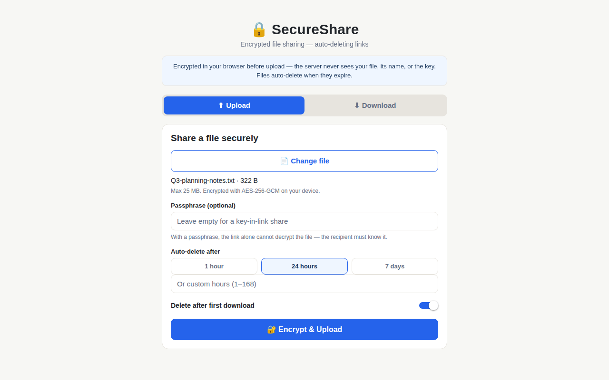
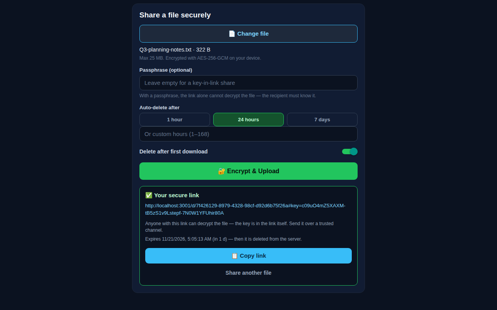
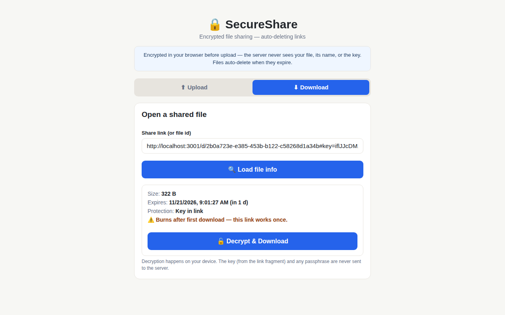
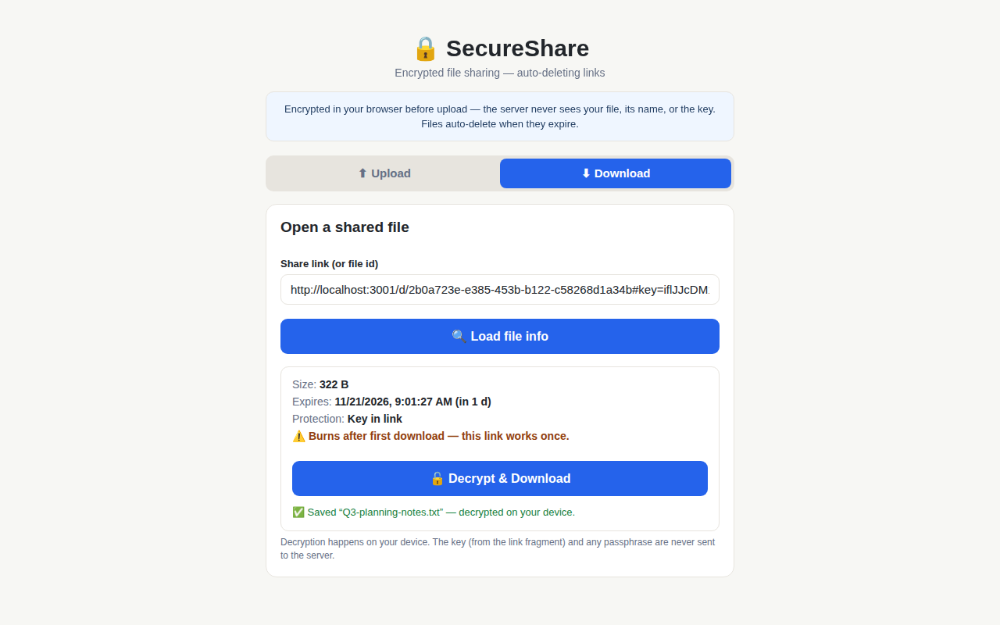
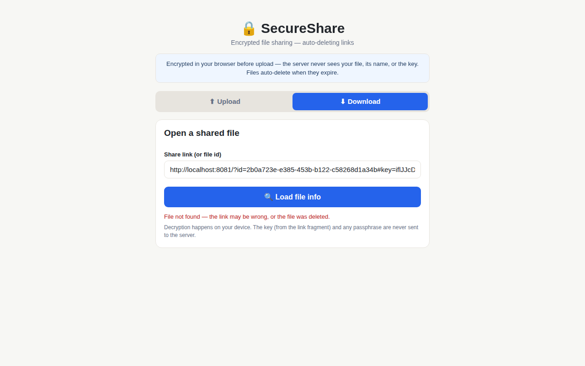
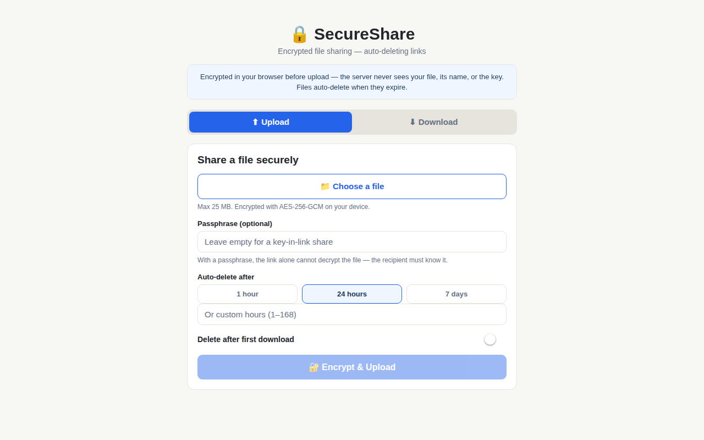
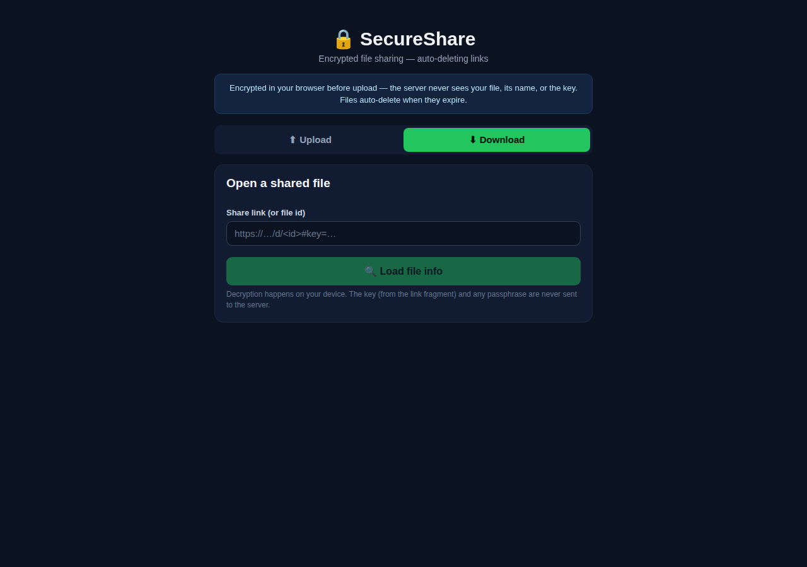

# 🔒 SecureShare — Encrypted File Transfer

> Share files through expiring links. Every file is encrypted with **AES-256-GCM
> on your device before upload** — the server only ever stores ciphertext, and
> the decryption key travels in the share link's URL fragment, which browsers
> never send to the server. Files auto-delete when they expire.

[](https://developer.mozilla.org/docs/Web/JavaScript)
[](https://expo.dev/)
[](https://reactnative.dev/)
[](https://nodejs.org/)
[](app/src/crypto/crypto.js)
[](tests/)
[](LICENSE)

---

## 📑 Contents

- [See it working](#-see-it-working)
- [Features](#-features)
- [Architecture](#%EF%B8%8F-architecture)
- [Crypto design & threat model](#-crypto-design--threat-model)
- [Quick start](#-quick-start)
- [Testing](#-testing)
- [Project structure](#-project-structure)
- [WebCrypto on native](#-webcrypto-on-native-react-native)
- [Roadmap](#%EF%B8%8F-roadmap)
- [Author](#-author)
- [License](#-license)

## 🎬 See it working

A real end-to-end run, captured live against the local server: one file
(`Q3-planning-notes.txt`, 322 B) encrypted, uploaded, shared, downloaded,
decrypted — then burned. The decrypted download was verified byte-identical
to the original.

| Step | What happens |
|---|---|
| **1. Upload — file selected, 24h expiry, burn-after-reading on** |  |
| **2. Share link — key travels in the `#key=` fragment, never to the server** |  |
| **3. Download — paste the link, see the file info before decrypting** |  |
| **4. Decrypted — saved with its original name, on your device** |  |
| **5. Burned — the same link opened again: the file is gone** |  |

> 🔑 The `#key=` value visible in these screenshots is real — but its file
> was burned immediately after the download, so it decrypts nothing. The
> shots were captured with [`docs/capture-screenshots.py`](docs/capture-screenshots.py)
> (Playwright driving the real UI against a live local server).

The two screens on their own:

| Upload — pick, protect, set expiry | Download — paste a link, decrypt locally |
|---|---|
|  |  |

## ✨ Features

| Feature | Details |
|---|---|
| **Client-side AES-256-GCM** | Files are encrypted in the browser/app with WebCrypto before anything leaves the device |
| **Key-in-fragment links** | The random 256-bit key lives in the `#key=…` URL fragment — never sent to the server |
| **Optional passphrase** | PBKDF2-SHA-256, 600,000 iterations, random 16-byte salt; with a passphrase the link alone cannot decrypt |
| **Encrypted filenames** | The original filename is encrypted with the same key (separate IV) — the server never learns it |
| **Integrity checks** | SHA-256 of the ciphertext is verified before decrypting; GCM's auth tag fails on any tampering |
| **Auto-delete** | Expiry presets (1 hour / 24 hours / 7 days) + custom hours; a sweeper deletes expired files every 5 minutes and on startup |
| **Burn after reading** | Optional one-time links — deleted after the first successful download |
| **Hardened server** | Security headers, 25 MB upload cap, UUID ids, path-traversal-safe storage, SHA-256 re-verification on upload |

## 🏗️ Architecture

```
  ┌────────────────────── Expo app (React Native / Web) ──────────────────────┐
  │  Upload screen: pick file → AES-256-GCM encrypt → upload ciphertext      │
  │  Download screen: paste link → fetch ciphertext → verify SHA-256 →       │
  │  decrypt locally → save file. Keys NEVER leave the device except in the  │
  │  #key= URL fragment (which browsers never send to any server).           │
  └───────────────────────────────┬───────────────────────────────────────────┘
                                  │ HTTPS / HTTP (API only, ciphertext only)
  ┌───────────────────────────────▼───────────────────────────────────────────┐
  │  Node.js + Express server (server/) — no database                        │
  │    POST /api/upload            multipart ciphertext + metadata           │
  │    GET  /api/files/:id/meta    public metadata (no key material)         │
  │    GET  /api/files/:id/download  streams ciphertext (410 if expired)     │
  │    DELETE /api/files/:id       manual delete                             │
  │    GET  /d/:id                 share-link page → JS redirect to the app  │
  │    Sweeper: deletes expired files every 5 min + on startup              │
  └───────────────────────────────┬───────────────────────────────────────────┘
                                  │
                    server/storage/<id>.bin   (ciphertext blob)
                    server/storage/<id>.json  (iv, salt, sha256, enc. name…)
```

### How a share works

1. **Upload:** the app generates a random 256-bit key + 12-byte IV, encrypts
   the file (AES-256-GCM) and the filename (same key, separate IV), hashes the
   ciphertext (SHA-256), and uploads only the ciphertext + non-secret metadata.
2. **Share link:** `https://<server>/d/<id>#key=<base64url-key>`. The `/d/` page
   is a tiny redirect: its JavaScript reads the fragment in the browser and
   forwards to the app — the fragment is never sent to the server.
3. **Download:** the app fetches the metadata + ciphertext, verifies the
   SHA-256 hash, decrypts locally with the key from the fragment (or the
   passphrase-derived key), and saves the file with its original name.
4. **Expiry:** the server deletes the blob + metadata at expiry (sweeper +
   lazy delete on access). Expired downloads return `410 Gone`.

## 🔐 Crypto design & threat model

**Parameters**

| Item | Value |
|---|---|
| Cipher | AES-256-GCM, 128-bit auth tag, 12-byte random IV per file |
| Key | Random 256-bit per file, or PBKDF2-derived (see below) |
| Passphrase KDF | PBKDF2-SHA-256, 600,000 iterations, 16-byte random salt |
| Integrity | SHA-256 of ciphertext (checked pre-decrypt) + GCM auth tag |
| Filename | AES-256-GCM with the file key and a dedicated IV |
| Key transport | URL fragment (`#key=`), or passphrase (key never in the link) |

**What this protects against**

- A compromised or curious **server operator**: the server holds only
  ciphertext, IVs, salts, hashes and encrypted filenames — it cannot read
  file contents or names, and cannot derive keys.
- **Network eavesdropping** (over HTTPS) and **tampering**: any flipped byte
  fails the SHA-256 check, and the GCM auth tag fails even if the stored hash
  were also rewritten (both are covered by tests).
- **Stale links**: files self-destruct at expiry; burn-after-reading links
  work exactly once.

**What it does NOT protect against**

- **Anyone with the link can decrypt** (key-in-link mode) — treat the link
  like the file itself and send it over a trusted channel. Use a passphrase
  when the link might leak: then the link alone is useless.
- **A malicious client / device compromise**: if the sender's or recipient's
  device is compromised, keys in memory or on screen can be stolen.
- **No user accounts or access control** in this simple version — possession
  of the link (and passphrase, if set) is the only authorization.
- **Metadata**: the server sees file sizes, expiry times and download counts.
- **Passphrase strength**: a weak passphrase can be brute-forced offline
  against the salt + ciphertext (PBKDF2 at 600k iterations only slows this).

## ⚡ Quick start

### 1. Start the server (port 3001)

```bash
cd server
npm install
npm start
# [secureshare] server listening on http://localhost:3001
```

Configuration via environment variables (see `server/.env.example`):
`PORT`, `STORAGE_DIR`, `MAX_FILE_MB` (default 25), `APP_URL` (default
`http://localhost:8081`), `SWEEP_INTERVAL_MS` (default 5 min).

### 2. Start the app (Expo web, port 8081)

```bash
cd app
npm install
npx expo start --web
# Open http://localhost:8081
```

The app talks to the API at `http://localhost:3001` by default; override with
`EXPO_PUBLIC_API_URL` (and `EXPO_PUBLIC_SERVER_URL` for share-link origins).

### 3. Try it

1. Pick a file, optionally set a passphrase and expiry, hit **Encrypt & Upload**.
2. Copy the share link and open it in a private window — the app jumps to the
   Download screen, loads the file info, and **Decrypt & Download** saves the
   original file.
3. Or build the static web export: `npx expo export --platform web`, then serve
   `app/dist/` with any static server.

## 🧪 Testing

```bash
# From the project root — 38 tests, Node's built-in runner, no framework
npm test
# or: node --test tests/crypto.test.mjs tests/server.test.mjs
```

| Suite | Covers |
|---|---|
| `tests/crypto.test.mjs` (25 tests) | AES-GCM round-trip, tamper detection (SHA-256 + GCM tag), wrong key / wrong passphrase failure, PBKDF2 determinism, filename encryption, SHA-256 test vector, base64url helpers, share-link build/parse |
| `tests/server.test.mjs` (13 tests) | Full upload → meta → download → decrypt round-trip (key + passphrase), delete, expired download → 410, sweeper deletion, burn-after-reading, SHA-256 mismatch rejection, oversize → 413, path-traversal rejection, security headers, `/d/` redirect page |

The crypto tests use the **real** WebCrypto (`globalThis.crypto`) — the app's
crypto module (`app/src/crypto/crypto.js`) is dependency-free and importable
in Node.

## 📁 Project structure

```
secureshare/
├── app/                        Expo app (JavaScript, SDK 58)
│   ├── App.js                  Upload + Download screens (state-based)
│   ├── app.json                name "SecureShare", slug "secureshare"
│   ├── index.js                Expo entrypoint
│   ├── src/config.js           API / server base URLs (EXPO_PUBLIC_*)
│   ├── src/crypto/crypto.js    WebCrypto module (AES-GCM, PBKDF2, links)
│   ├── src/crypto/polyfill-note.js  WebCrypto-on-native explainer
│   ├── src/platformFiles.js    Native file I/O (expo-file-system + sharing)
│   ├── src/platformFiles.web.js Web file I/O (File API + blob download)
│   └── package.json            (package-lock.json included)
├── server/                     Express API (no database)
│   ├── index.js                routes, sweeper, security headers
│   ├── storage/                encrypted blobs + metadata (git-ignored)
│   ├── .env.example            annotated config template
│   └── package.json            (package-lock.json included)
├── tests/                      node:test suites (38 tests)
├── docs/
│   ├── screenshots/            UI + real-flow screenshots used in this README
│   └── capture-screenshots.py  Playwright script that captured the flow shots
└── README.md
```

## 📱 WebCrypto on native (React Native)

The verified target is **Expo web**, where WebCrypto is built into the
browser. Raw React Native (Hermes/JSC on iOS/Android) has **no built-in
WebCrypto** — `globalThis.crypto.subtle` is undefined there, and the crypto
module throws a clear error instead of failing silently. To run on native,
add a WebCrypto shim (e.g. `react-native-get-random-values` + a
`react-native-webcrypto`-style shim, or `expo-crypto` for random bytes plus a
subtle-crypto provider). See `app/src/crypto/polyfill-note.js` for details.
The native file I/O paths (`platformFiles.js`, modern `File`/`Paths` API)
are implemented but were not run on a device/emulator in this build.

## 🗺️ Roadmap

- Streaming encryption for large files (currently whole-file in memory)
- Rate limiting + per-IP upload quotas on the server
- Optional user accounts / link passwords stored server-side (hashed)
- Native WebCrypto shim + device testing

## 👩‍💻 Author

**Potta Jyothsna** — Cybersecurity student (CEH & CLLMSE) at Parul
University, focused on VAPT and AI security. Open to internships.

- 🌐 Portfolio: [pottajyothsna.vercel.app](https://pottajyothsna.vercel.app/)
- 💼 LinkedIn: [linkedin.com/in/jyothsna6125](https://www.linkedin.com/in/jyothsna6125/)
- 🐙 GitHub: [github.com/DareToCrack](https://github.com/DareToCrack)

If this project helped you, a ⭐ on the repo is appreciated!

## 📄 License

MIT — free for educational and personal use.
